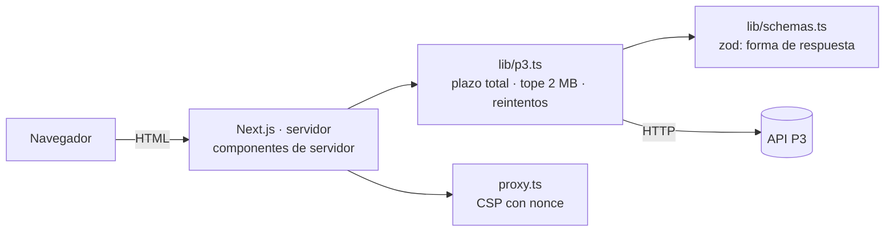

# 🌐 Web de mercado (Next.js)

Proyecto 5 del portafolio de finanzas. Web pública **de solo lectura** que muestra el mercado consumiendo **únicamente** la API propia del [proyecto 3](../03-api-mercado). Sin base de datos propia, sin cuentas, sin chat del agente y sin despliegue incluido (solo una guía más abajo).

> **Regla de diseño:** la web solo habla con P3. Todas las llamadas se hacen **en el servidor** (componentes de servidor de Next.js): el navegador nunca ve la URL de P3 ni la clave.

## 📄 Páginas

| Ruta | Contenido |
|---|---|
| `/` | Ranking (`/ranking` de P3) con selector de periodo (mes / trimestre / año en curso), métrica (retorno / volatilidad / Sharpe) y orden. «Primero del ranking» es la posición 1 según el orden elegido, **no un juicio de calidad** |
| `/ticker/[symbol]` | Ficha: gráfico de precios del último año (con tabla alternativa), métricas, y predicción de volatilidad con aviso visible de `in_sample` y de no-asesoría. Cada sección falla por separado |
| `/sectores` | Resumen por sector (cartera de igual ponderación) |
| `/modelo` | Información pública del modelo: versión, entrenamiento, métricas de test y referencias. No muestra hash, versiones de librerías ni avisos internos |

## 🏗️ Arquitectura



- `src/lib/env.ts`: configuración solo del servidor (`P3_BASE_URL`, `P3_API_KEY`, …). **Nunca** `NEXT_PUBLIC_*`.
- `src/lib/p3.ts`: cliente de P3. Plazo total (`P3_TIMEOUT_MS`) que incluye la lectura del cuerpo y los reintentos; lectura en *streaming* con tope de 2 MB (también si `Content-Length` ya lo supera); `Accept-Encoding: identity` y rechazo de cualquier `Content-Encoding` (sin bombas de descompresión); sin seguir redirecciones; reintentos (`P3_RETRIES`: 0–4, por defecto 2) solo ante fallos de red y 502-504 (429 y 4xx no se reintentan); caché en memoria (5 min para datos de mercado, 1 h para tickers y modelo) **solo de respuestas que ya pasaron la validación del esquema**: una respuesta 200 malformada no se guarda y la siguiente petición vuelve a consultar a P3.
- `src/lib/schemas.ts`: esquemas zod. Si la forma no coincide → «Respuesta inesperada de la API». Del modelo solo se leen campos públicos.
- `src/lib/api.ts`: un getter por endpoint (cableados según `03-api-mercado/app/routers/*.py`; no se usa `/openapi.json`). **El símbolo se valida por formato y contra `/tickers` antes de armar cualquier URL**; la ruta usa el símbolo canónico de la lista.
- `src/lib/text.ts`: `clean()` quita caracteres de control, bidi e invisibles y acota el largo del texto de la API; `null`/listas se muestran como `n/d`. React escapa el HTML y la regla de lint `react/no-danger` prohíbe `dangerouslySetInnerHTML`.

## 🔒 Seguridad

- **CSP estricta con nonce por petición** (`src/proxy.ts`), sin `unsafe-inline` ni `unsafe-eval` en producción: `default-src 'self'`, `script-src 'self' 'nonce-…' 'strict-dynamic'`, `object-src 'none'`, `base-uri 'self'`, `frame-ancestors 'none'`. Por eso las páginas son de render dinámico. El código no usa estilos en línea (los gráficos se estilan con CSS).
- Rutas con codificación porcentual inválida (`/ticker/%`, `/ticker/%zz`…): Next respondería 500 en texto plano y sin cabeceras; `proxy.ts` las intercepta antes y devuelve un **400 con página amigable** y las cabeceras de seguridad (CSP `default-src 'none'`, `nosniff`, …).
- Favicon propio (`src/app/icon.svg`, sin fuentes ni recursos externos).
- Saneado: el texto de la API se limpia ya en los esquemas (control, ANSI, bidi, invisibles), por lo que tampoco viaja sucio en el payload RSC que Next incrusta en el HTML. Los campos de enumeraciones y fechas se validan con lista cerrada/regex.
- Cabeceras: `X-Content-Type-Options: nosniff`, `Referrer-Policy: no-referrer`, `X-Frame-Options: DENY`, `Strict-Transport-Security`, `Permissions-Policy`, `Cross-Origin-Opener-Policy`; `poweredByHeader: false`.
- Los errores se muestran con mensajes amigables; nunca trazas ni el mensaje interno. Los parámetros de la URL del ranking se validan con una lista cerrada (valor inválido → valor por defecto).
- Dependencias fijadas (`save-exact` + `package-lock.json`), CI con acciones por SHA y permisos mínimos, `dependabot.yml` (npm + github-actions).
- `npm audit` de **producción**: 0 vulnerabilidades. El `npm audit` completo marca 5 avisos *high* que son una sola cadena solo de desarrollo (`eslint-config-next → @next/eslint-plugin-next → fast-glob → micromatch → braces`, ReDoS en patrones glob) **sin versión corregida** disponible; no se incluye en el build ni se ejecuta en producción. El CI audita solo producción por esta razón.

## ⚙️ Variables de entorno (solo servidor)

| Variable | Por defecto | Descripción |
|---|---|---|
| `P3_BASE_URL` | `http://127.0.0.1:8000` | URL de la API P3 (http/https, sin credenciales ni caracteres de control; si no, la web muestra «Configuración incompleta») |
| `P3_API_KEY` | — | Opcional. Se envía como `X-API-Key`; nunca llega al navegador |
| `P3_TIMEOUT_MS` | `8000` | Plazo total por consulta (1000–60000) |
| `P3_RETRIES` | `2` | Reintentos ante red/502-504 (0–4) |

Copia `.env.example` a `.env.local` (no se versiona).

## ▶️ Cómo correrlo

```bash
npm ci
cp .env.example .env.local        # y ajusta P3_BASE_URL
npm run dev                        # http://localhost:3000
# producción local:
npm run build && npm start
```

Necesitas una P3 en marcha. Para una local con datos de ejemplo (sin Docker):

```bash
cd ../03-api-mercado
DATABASE_URL=sqlite:///./local.db RATE_LIMIT_ENABLED=false alembic upgrade head
DATABASE_URL=sqlite:///./local.db python -m app.etl --seed
DATABASE_URL=sqlite:///./local.db RATE_LIMIT_ENABLED=false uvicorn app.main:create_app --factory --port 8765
```

### Pruebas

```bash
npm run lint         # eslint (sin avisos)
npm run typecheck    # tsc --noEmit
npm test             # vitest, P3 simulada (fetch simulado), sin red
npm run build
```

- Los tests cubren: cliente (plazo, goteo, tope de tamaño, `Content-Encoding`, 404/429/5xx, reintentos acotados, API caída, configuración inválida), validación de símbolo (inyección de ruta), esquemas, CSP, formato/saneado y componentes/páginas clave (aviso `in_sample`, gráfico accesible, estados de error).
- **e2e opcional contra una P3 real** (se omite sin la variable): `P3_E2E_URL=http://127.0.0.1:8765 npm run test:e2e`.
- **Humo contra la web levantada** (`npm run build && npm start`): `WEB_URL=http://127.0.0.1:3000 npm run smoke` comprueba páginas, 404 de símbolos inválidos, CSP y cabeceras (se omite sin `WEB_URL`).

## ♿ Accesibilidad

Colores con buen contraste en modo claro y oscuro (sigue `prefers-color-scheme`; no hay interruptor manual), enlace «Saltar al contenido», foco visible, tablas con `caption`/`scope`, gráfico SVG con `role="img"` y descripción textual, y una **tabla alternativa** con los mismos datos. La información no depende solo del color. No se ha auditado con lectores de pantalla reales.

## 🚀 Despliegue sugerido (no incluido)

Cualquier plataforma con Node ≥ 22 (p. ej. Render, Railway o Vercel): `npm ci && npm run build`, arranque `npm start`, y definir `P3_BASE_URL` (y `P3_API_KEY` si aplica) como variables **del servidor**. Si P3 está en un plan gratuito que se duerme, la web muestra «La API no responde» y se reintenta sola cada 20 s, **como máximo 5 veces seguidas** (sin JavaScript: `<meta refresh>` con un contador `?r=` en la URL); después queda un mensaje estático para reintentar manualmente (el botón reinicia el contador). Los 429 y los errores no transitorios no se refrescan solos. La caché en memoria es por proceso: con varias réplicas cada una tendrá la suya. Detrás de un proxy, mantén las cabeceras de seguridad y HTTPS.

## ⚠️ Límites y resultados honestos

- La web solo muestra lo que calcula P3: no recalcula nada. Las métricas de la ficha usan todo el historial; el gráfico, el último año.
- La predicción viene de un modelo con ventaja **modesta** sobre referencias simples (ver `/modelo`); si la fecha cae en la muestra de entrenamiento (`in_sample`) se advierte de forma visible.
- `/ticker/[symbol]` no tiene pantalla de «cargando» (para poder responder un 404 real a símbolos inexistentes); si P3 está dormida, la página tarda hasta `P3_TIMEOUT_MS` y luego muestra el estado de reintento.
- La caché en memoria significa que los datos pueden tener hasta 5 minutos de retraso.
- Next.js 16 y TypeScript 6 son versiones muy recientes: se fijaron las exactas que resolvió npm en el momento de crear el proyecto.

## Datos y aviso de uso

Los datos provienen de la API P3, que los obtiene de Yahoo Finance vía `yfinance` (sin afiliación con Yahoo; uso educativo y no comercial; los términos de Yahoo aplican a los datos). La licencia MIT cubre el código, no los datos. Nada de lo que muestra esta web constituye asesoría ni recomendación de inversión.

## Licencia

MIT — ver [LICENSE](LICENSE).
